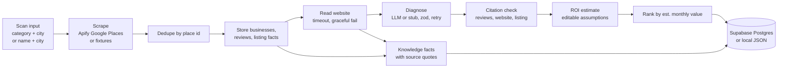

# ringring.run

Find the local businesses that are losing money to missed calls, then show them exactly where, with proof.

ringring.run scans Google Maps listings for a category and city (or one business by name), reads each business's reviews and homepage, and asks an LLM to diagnose revenue leaks such as unanswered calls, slow quotes, hard booking, and ignored reviews. Every finding must cite a real review quote, a listing fact, or a quote from the business website, and a code check drops any finding whose quote cannot be found word for word. Each surviving finding gets a monthly dollar estimate built from editable assumptions, and businesses are ranked by that estimate.

Built for the AITX x MLOps World hackathon (Antler agents track). This repo is Phase 1: the scanner. There are no phone calls, voice agents, outreach, or payments in this codebase yet.

> Disclosure: Adam previously explored a related business scanner idea in other projects. This codebase is new and was written from scratch for this hackathon. No code was copied from those projects.

## What works today

- Scan by category and city (`plumbers`, `Austin TX`) or by one business name (`Joe's Plumbing, Austin TX`).
- Google Maps listings and reviews via the Apify actor `compass~crawler-google-places` (REST, start then poll).
- Dedupe by Google place id before anything is stored.
- Read website step: fetches the listing's homepage text with an 8 second timeout, a 1 MB size cap, at most 3 redirects, and a block on private and localhost addresses. A failed read is logged as a warning and the scan continues with reviews and listing data.
- LLM diagnosis through an OpenAI-compatible endpoint (xAI by default), with strict JSON output validated by zod and retries with backoff.
- Citation check: review and website quotes must be exact substrings of the stored text (after Unicode normalization). Listing facts must be true for that listing. Numbers in a finding must appear in its evidence. Anything that fails is dropped and logged.
- ROI estimate per finding as a product of named assumptions (missed calls per week, close rate, average ticket, and so on). Every assumption is editable in the UI or via the API, and totals recompute.
- Knowledge facts per business (contact, hours, services, prices, booking policy), each with its source and the exact quote it came from. These are stored so a future voice agent knowledge pack can be generated from them. No voice agent is built.
- One failing business never fails the run. The run ends as `completed_with_errors` and the failure is logged.
- Web UI: landing page at `/`, dashboard at `/dashboard`, run view at `/runs/[id]`, business view at `/businesses/[id]`, and `/health`.
- CLI: `pnpm scan`.

## How it works



Each business runs website, diagnose, validate, and ROI with a concurrency of 3. Every step writes a row to `run_steps`, which the UI shows as a live log.

## Setup

Requires Node 20 or later (22 recommended) and pnpm.

```bash
pnpm install
cp .env.example .env.local   # then fill in the keys you have
pnpm dev                     # http://localhost:3000
```

Open `/health` to see which keys the app can see. It shows names and true/false only, never values.

## Environment variables

Put these in `.env.local` (gitignored). Never commit real values.

| Name | Required for live mode | Where to get it |
| --- | --- | --- |
| `APIFY_TOKEN` | Yes, for real Google Maps data | Apify Console > Settings > API & Integrations |
| `XAI_API_KEY` | Yes, for LLM diagnosis | console.x.ai > API Keys |
| `SUPABASE_URL` | Yes, for Postgres storage | Supabase project > Project Settings > API |
| `SUPABASE_SERVICE_ROLE_KEY` | Yes, for Postgres storage | Supabase project > Project Settings > API (service_role, server only) |
| `NEXT_PUBLIC_SUPABASE_URL` | No, reserved, unused in Phase 1 | Same as `SUPABASE_URL` |
| `NEXT_PUBLIC_SUPABASE_ANON_KEY` | No, reserved, unused in Phase 1 | Supabase project > Project Settings > API (anon) |
| `LLM_MODEL` | No | Model id, default `grok-4.7` |
| `LLM_BASE_URL` | No | OpenAI-compatible base URL, default `https://api.x.ai/v1` |
| `LLM_API_STYLE` | No | `responses` (default) or `chat` |
| `LLM_API_KEY` | No | Key for a non-xAI endpoint, overrides `XAI_API_KEY` |
| `LLM_REASONING_EFFORT` | No | `low`, `medium`, or `high` for models that support it |
| `APIFY_MAX_REVIEWS` | No | Reviews per place, default 20 |
| `APIFY_TIMEOUT_SECS` | No | Apify run timeout |
| `FORCE_DEMO` | No | Set to `1` to force demo mode even with keys |
| `LOCAL_DB_PATH` | No | Local store file, default `.data/local-db.json` |

Each group switches on independently. For example, with only `XAI_API_KEY` set, the app uses fixtures and the local store but a real LLM.

## Database

Apply the migration to your Supabase project, either in the SQL editor or with the Supabase CLI:

```bash
supabase db push   # or paste supabase/migrations/20261026000000_init.sql into the SQL editor
```

Tables: `runs`, `run_steps`, `businesses`, `reviews`, `web_pages`, `findings`, `roi_estimates`, `knowledge_facts`. RLS is enabled on all of them, and the server uses the service role key.

## Scanning

From the UI: open `/dashboard`, choose "Category and city" or "One business by name", and start a scan. The run page updates live.

From the CLI:

```bash
pnpm scan plumbers "Austin TX" 12             # category, city, max businesses
pnpm scan --name "Joe's Plumbing, Austin TX"  # one business by name
pnpm scan --name "Joe's Plumbing" "Austin TX" # same, city as its own argument
```

From the API:

```bash
curl -X POST localhost:3000/api/scan -H 'content-type: application/json' \
  -d '{"category":"plumbers","city":"Austin TX","maxCount":10}'
curl -X POST localhost:3000/api/scan -H 'content-type: application/json' \
  -d '{"name":"Joe'"'"'s Plumbing, Austin TX"}'
curl localhost:3000/api/runs/<runId>          # status, steps, ranked businesses
curl localhost:3000/api/businesses/<id>       # findings, ROI, website, knowledge facts
curl -X PATCH localhost:3000/api/roi/<roiId> -H 'content-type: application/json' \
  -d '{"assumptions":{"missed_calls_per_week":20}}'
curl localhost:3000/api/health               # mode and env key presence (true/false)
```

## Demo mode (fixtures)

Demo mode exists only for missing keys. When a key group is missing, that part of the pipeline uses a stand-in and the UI shows a "Demo data" badge:

- No `APIFY_TOKEN`: 12 fictional businesses with names like "Example Plumbing Co" and "Demo Rooter Services", `example.com` websites, and `555` phone numbers. They do not exist. Fixture websites are never fetched over the network.
- No LLM key: a keyword rule diagnoser stands in for the LLM.
- No Supabase keys: a local JSON file at `.data/local-db.json`.

The fixtures deliberately include one business whose diagnosis always fails (to show the run continuing), one whose website read times out, two with no website, and one where the diagnoser cites a quote that is not in any review (to show the citation check dropping it). A by-name scan in demo mode cannot look up real businesses. It matches a fixture name if one fits, and otherwise shows a fictional sample with a warning.

## Tests

```bash
pnpm test    # vitest
pnpm build
```

Tests cover the diagnosis and scan input schemas, the citation substring check (reviews, website, listing facts, numbers), ROI math and edits, the website reader (timeouts, redirects, non-HTML, private address blocking), and the full pipeline in fixture mode, including a failing business whose run continues, dedupe by place id, by-name scans, and knowledge facts.

## Not built yet

- Voice calls, phone agents, outreach of any kind, and payments.
- The knowledge pack itself. The data model (`knowledge_facts`) and listing and website extraction exist; FAQs and owner-provided facts are not populated yet.
- Phase 1 has not yet been run against live Apify, xAI, or Supabase.

## Guardrails

- The scanner never contacts a business. Anything sent to a real person later must be a draft a human approves.
- Secrets come from environment variables only and are never logged or shown.
- Every estimate is labeled as an estimate built from editable assumptions.
