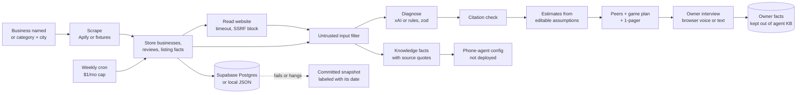

# ringring.run

**Ringy talks, Rungy runs.** ringring.run is a consigliere for boring local businesses (HVAC, plumbing, cafes, salons, dentists, music shops). It reads what the public already says about a business, shows the owner where they are losing customers with real review quotes as proof, ranks them against anonymized local peers, and hands them a short game plan that says plainly who does each step.

- **Rungy runs** the background work: scans the Google Maps listing, reviews and website, diagnoses problems, benchmarks against peers, builds a cited phone-agent config, and re-checks the business every week under a hard budget cap.
- **Ringy talks** with the owner: today that means an owner interview in the browser, by voice or by typing. Phone calls and SMS are not live.

Built for the AITX x MLOps World hackathon (Antler agents track).

> Disclosure: Adam previously explored a related business scanner idea in other projects. This codebase is new and was written from scratch for this hackathon. No code was copied from those projects.

## What works today, with proof

Each line names how it was checked. "Live" means it ran against the real service on the date given; "test" means an automated test in `tests/` (run with `pnpm test`).

| Feature | Where | Proof |
| --- | --- | --- |
| Scan one business by name, or a category and city, from Google Maps (Apify `compass~crawler-google-places`) | `/owners`, `/dashboard`, `pnpm scan` | Live, 2026-10-26 (12 Austin restaurants; by-name scans). Fixture pipeline tests |
| Diagnosis where every finding cites a real review, listing fact or website quote; a code check drops any quote that is not found word for word | `/businesses/[id]/diagnosis` | Live with xAI `grok-4.7`, 2026-10-26. Citation tests; eval "Diagnosis cites real reviews" |
| Your peers: anonymized Austin tier list and leaderboard, with the tier formula shown | diagnosis page | `src/data/peers.json`: 111 anonymized Austin businesses in 6 industries, scanned 2026-10-26. Eval "Peers stay anonymized" |
| Game plan: scorecard, the one binding constraint, tiered steps labeled "Ringy does this", "Ringy does this after your OK" or "You do this" | diagnosis page | Tests; eval "Overlap rule" |
| Printable 1-pager (no price, no money-back promise) | `/businesses/[id]/one-pager` | Tests; screenshots |
| Owner interview: Ringy asks the questions from `src/data/interview.json` (and the game plan's open questions), the owner answers by voice in the browser or by typing, and answers are saved to the business profile | `/businesses/[id]/interview` | Tested end to end in a real browser (headless Chrome) against a real ElevenLabs Conversational AI session with a **scripted microphone** (recorded answers played into the mic input), 2026-10-26: all 5 questions asked in order, all 5 answers transcribed, mapped, saved and shown after reload (`scripts/e2e/interview-voice.mjs`). Not yet tried by a person on a real microphone. 18 unit and route tests |
| Weekly check-in: light rating and review-count check, new reviews only when the count went up, a deeper refresh monthly, under a monthly cap (default $1.00) | Vercel Cron `/api/cron/checkin`, Mondays 15:00 UTC | Tests with mocked Apify (no spend). Needs `CRON_SECRET` in the deploy env; not set here, so not run live |
| Phone-agent config per business: AI disclosure first, every fact numbered and cited, rules for unknown answers, bookings, after hours, upset callers | business page | Tests; simulated caller evals 10/10 (fixture), 8/8 live LLM on 2026-10-26 before the 2 new cases were added |
| Demo-safe fallback: if Supabase, Apify or xAI fail or hang (8 s timeout), the Aire Serv flow renders from a committed real report labeled "Saved snapshot from Oct 26, 2026", with editing, voice and saving off | every Aire Serv page | Tests simulate each failure; screenshots with Supabase pointed at a dead port |
| Eval panel: rule checks run on real saved reports, plus simulated callers | `/evals`, `pnpm eval` | 8/8 rule checks and 10/10 callers at the last commit |
| Customer mode: nearby businesses from OpenStreetMap on a map, and chat with a business's AI built only from cited facts | `/find` | Tests; bundled Austin OSM snapshot when public Overpass mirrors are down |

### Not live (do not claim)

- **No phone calls.** Nothing in this codebase answers or places a call. The phone-deploy adapter exists, is off without `ELEVENLABS_PHONE_NUMBER_ID`, and has not been tested against the live API.
- **No SMS, no Spanish, no calendar booking, no payments, no outreach of any kind.** The evals fail any owner-facing copy that claims phone answering, texting, Spanish, "every call" or 24/7.
- Interview answers are stored as owner-provided facts. They do not yet change the diagnosis or dollar figures, and they are deliberately kept out of the phone agent's knowledge base.

## How to run

Requires Node 22 (20 works with a deprecation warning) and pnpm.

```bash
pnpm install
cp .env.example .env.local   # fill in only the keys you have
pnpm dev                     # http://localhost:3000
```

With no keys at all, everything runs in demo mode on fictional fixtures (`Example Plumbing Co`, `555` numbers, `example.com` sites) and a local JSON store, with a "Demo data" badge. `/health` shows which keys the server can see (names and true/false only, never values).

Demo path: `/owners` > find the business > diagnosis (findings, peers, game plan) > "Answer with Ringy" (interview) > 1-pager. `/evals` shows the checks.

Checks (CI runs all five with no secrets):

```bash
export NODE_OPTIONS=--experimental-websocket   # Node 20 only, for supabase-js realtime
pnpm lint && pnpm typecheck && pnpm test && pnpm eval && pnpm build
```

Voice interview end-to-end test (needs a running server with `ELEVENLABS_API_KEY` in its env, Chrome, and answer clips in `/tmp/voice`; uses a few minutes of ElevenLabs conversation quota):

```bash
BASE=http://localhost:3000 BID=<business id> node scripts/e2e/interview-voice.mjs
```

## Architecture



- Next.js 16 App Router, strict TypeScript, zod on API inputs and model output, Supabase Postgres (or a local JSON file), Tailwind.
- Each business runs website, diagnose, validate, estimate and agent steps with a concurrency of 3. Every step writes a row to `run_steps`, which the run page shows live. One failing business never fails the run.
- **Voice interview** (`src/lib/interview*.ts`, `src/app/api/businesses/[id]/interview/`): the server builds an ElevenLabs Conversational AI agent per business and question set (English, end-call tool, 5 minute cap) and hands the browser a short-lived signed URL, so the API key never leaves the server. Questions must come from Ringy's own question bank, so nothing typed into the request can rewrite the agent's prompt. After the call the server reads the transcript (only for that business's agent), maps answers to questions, and the owner reviews and edits them before anything is saved.

## Untrusted input

Reviews, listings, and websites are written by strangers, so they are treated as data, never instructions (`src/lib/untrusted.ts`):

- Normalize (NFKC) and strip zero-width and bidi control characters.
- Replace instruction-like spans ("ignore previous instructions", "you are now", role markers, chat tokens, "reveal your prompt", and similar) with `[instruction-like text removed]`.
- Wrap every scraped value in `<untrusted_data source=... id=...>` fences. Fence tags inside the text are defanged so it cannot close its own fence.
- Both the diagnosis prompt and the agent prompt carry a security rule: fenced text is data and loses any conflict with the rules.
- Suspicious lines are never stored as knowledge facts or FAQs, so injected text cannot become something the agent says. The business page marks such reviews "Prompt injection ignored".

The demo fixture includes an injected website line and an injected review on purpose; tests check that neither reaches the agent.


## Guardrails

- **Opt-in only.** Nothing contacts a business. No AI cold calls or cold texts (TCPA; the FCC treats AI voices as artificial voice). The owner starts every conversation, and anything sent to a real person later must be a draft a human approves.
- **Every number traced.** Every $ or % shown to an owner comes from data on file or is labeled an estimate with its math visible. The eval "Every $ and % is traceable" fails any figure without a source.
- **$1/month cron cap.** Weekly check-ins stop when the month's spend would pass `CHECKIN_MONTHLY_BUDGET_USD` (default $1.00). Spend is logged per check from Apify's charged events. Estimate for one business's light check: $0.004 (place) + $0.002 (place details) + 4 × $0.00005 (actor start) = $0.0062, from the Apify actor's per-event pricing read in Oct 2026 (`src/lib/checkin/logic.ts`).
- **Agents say they are an AI** in the first message and whenever asked; the schema rejects a config that does not.
- **Peers stay anonymized**, and reviews with discrimination or other allegations are never quoted.
- **No claims beyond what is tested.** The evals fail copy that claims phone answering, SMS, Spanish, every call, or 24/7.
- **Secrets** come from environment variables only and are never logged, shown or sent to the browser.

## Environment variables

Put these in `.env.local` (gitignored). Never commit real values.

| Name | Required for live mode | Where to get it |
| --- | --- | --- |
| `APIFY_TOKEN` | Yes, for real Google Maps data | Apify Console > Settings > API & Integrations |
| `XAI_API_KEY` | Yes, for LLM diagnosis | console.x.ai > API Keys |
| `SUPABASE_URL` | Yes, for Postgres storage | Supabase project > Project Settings > API |
| `SUPABASE_SERVICE_ROLE_KEY` | Yes, for Postgres storage | Supabase project > Project Settings > API (service_role, server only) |
| `NEXT_PUBLIC_SUPABASE_URL` | No, reserved, unused in Phase 1 | Same as `SUPABASE_URL` |
| `NEXT_PUBLIC_SUPABASE_ANON_KEY` | No, reserved, unused in Phase 1 | Supabase project > Project Settings > API (anon) |
| `LLM_MODEL` | No | Model for diagnosis, default `grok-4.7` |
| `LLM_CHAT_MODEL` | No | Model for chat, concierge and simulated call turns, default `grok-4.20-0309-non-reasoning` (fast, no reasoning) |
| `LLM_BASE_URL` | No | OpenAI-compatible base URL, default `https://api.x.ai/v1` |
| `LLM_API_STYLE` | No | `responses` (default) or `chat` |
| `LLM_API_KEY` | No | Key for a non-xAI endpoint, overrides `XAI_API_KEY` |
| `LLM_REASONING_EFFORT` | No | `low`, `medium`, or `high` for models that support it |
| `APIFY_MAX_REVIEWS` | No | Reviews per place, default 20 |
| `APIFY_TIMEOUT_SECS` | No | Apify run timeout |
| `OVERPASS_URL` | No | Overpass endpoint(s) for `/find`, comma separated, tried in order. Default: overpass.private.coffee, then maps.mail.ru |
| `FORCE_DEMO` | No | Set to `1` to force demo mode even with keys |
| `LOCAL_DB_PATH` | No | Local store file, default `.data/local-db.json` |
| `CRON_SECRET` | For cron | Bearer secret for `/api/cron/checkin`; Vercel Cron sends it automatically. Route returns 503 without it |
| `CHECKIN_MONTHLY_BUDGET_USD` | No | Hard monthly cap on check-in spend, default `1.00` |
| `ELEVENLABS_API_KEY` | For the voice interview, and to deploy an agent | ElevenLabs > Developers > API Keys. The key needs Conversational AI access. Server only, never sent to the browser |
| `INTERVIEW_VOICE` | No | Set to `off` to make the owner interview text-only |
| `ELEVENLABS_PHONE_NUMBER_ID` | Only to deploy an agent | ElevenLabs Agents > Phone Numbers (a number already imported there) |

Each group switches on independently. For example, with only `XAI_API_KEY` set, the app uses fixtures and the local store but a real LLM.

## Database

Apply the migration to your Supabase project, either in the SQL editor or with the Supabase CLI:

```bash
supabase db push   # or paste each file in supabase/migrations/ into the SQL editor, in order
```

Tables: `runs`, `run_steps`, `businesses`, `reviews`, `web_pages`, `findings`, `roi_estimates`, `knowledge_facts`, `agents`. RLS is enabled on all of them, and the server uses the service role key. `20261028000000_harden_rls.sql` adds a restrictive deny policy for `anon` and `authenticated` on every table and revokes their table grants, so the publishable (anon) key cannot read or write anything; only the server, with `SUPABASE_SERVICE_ROLE_KEY`, can.


## API

```bash
curl -X POST localhost:3000/api/scan -H 'content-type: application/json' -d '{"name":"Joe'"'"'s Plumbing, Austin TX"}'
curl localhost:3000/api/runs/<runId>                 # status, steps, ranked businesses
curl localhost:3000/api/businesses/<id>              # report, including saved interview answers
curl -X POST localhost:3000/api/businesses/<id>/interview -H 'content-type: application/json' \
  -d '{"mode":"text","answers":[{"question":"About how many calls do you think go unanswered in a normal week?","answer":"About 8"}]}'
curl localhost:3000/api/evals/product                # rule checks on saved reports
curl localhost:3000/api/health                       # mode and key presence (true/false)
```
